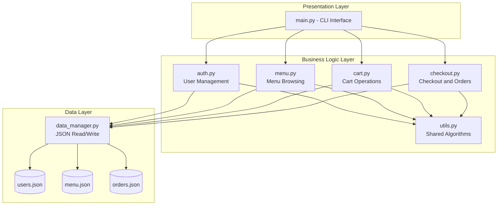
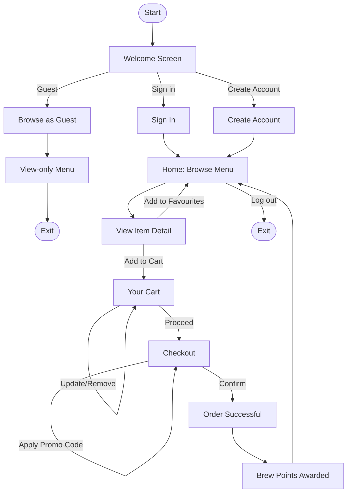
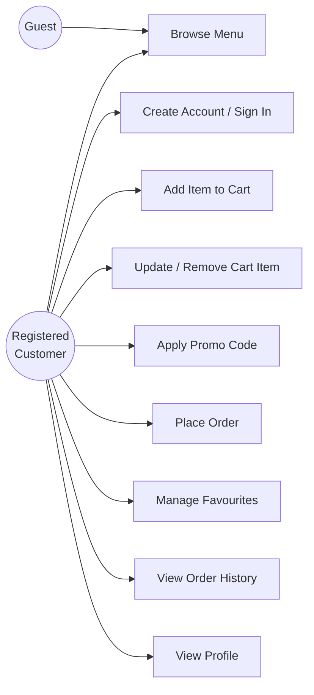
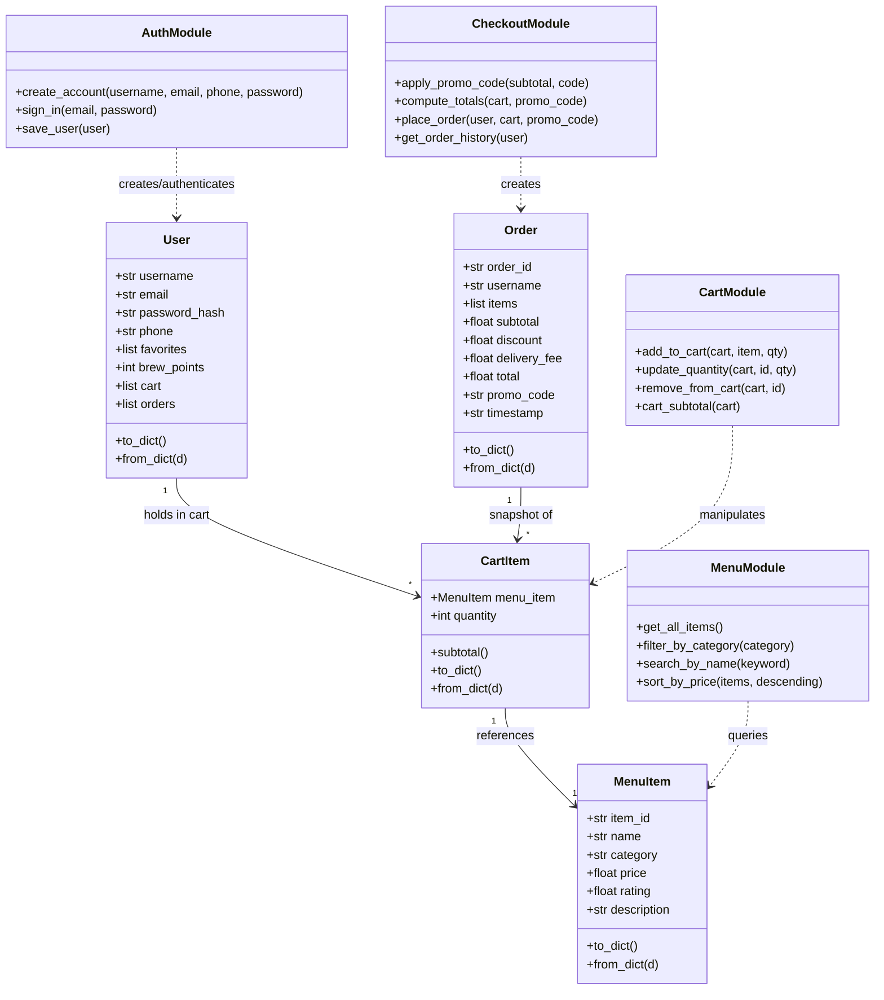
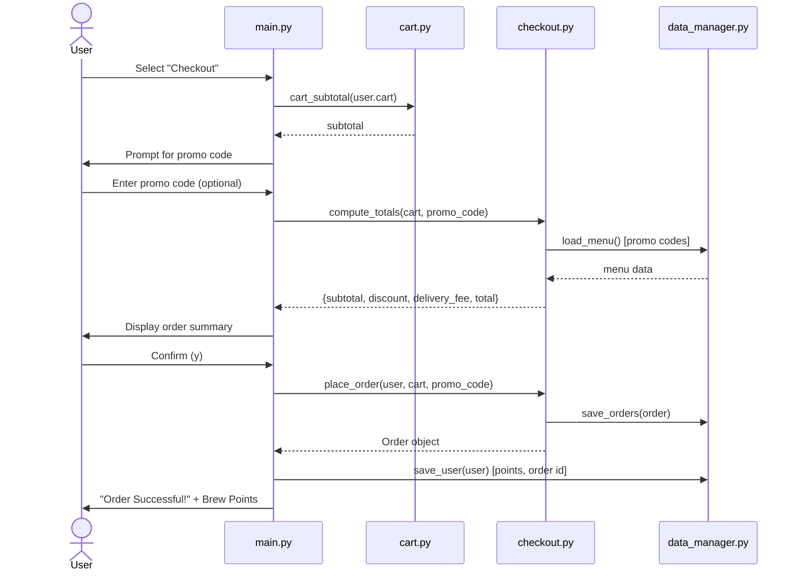
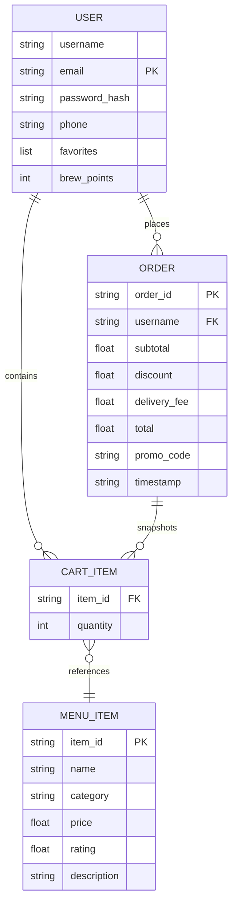

# Brewly Artisan Café - Design Documentation

This document contains the architectural and behavioural diagrams for the
BREWLY CLI project. All diagrams are written in **Mermaid** syntax, which
GitHub renders automatically when viewing this file in the browser.

---

## 1. System Architecture Diagram

Shows how the CLI (presentation layer) talks to the functional modules
(business logic layer), which in turn talk to the JSON persistence layer
(data layer).

---

## 2. Process Flow / Workflow Diagram

Mirrors the original Figma user flow: Welcome -> Auth -> Home -> Product
Detail -> Cart -> Checkout -> Order Success.

---

## 3. Use Case Diagram

---

## 4. Class / Component Diagram

---

## 5. Sequence Diagram - "Place an Order"

---

## 6. Data / Storage Design

BREWLY uses flat-file **JSON storage** (no external database server needed,
keeping the project runnable anywhere with plain Python). The structure
below is the logical equivalent of an ER diagram for this storage model.

**Schema files:**
- `brewly/data/menu.json` — menu items + promo codes (seed data, version-controlled)
- `brewly/data/users.json` — created at runtime (gitignored, holds registered users)
- `brewly/data/orders.json` — created at runtime (gitignored, holds placed orders)
